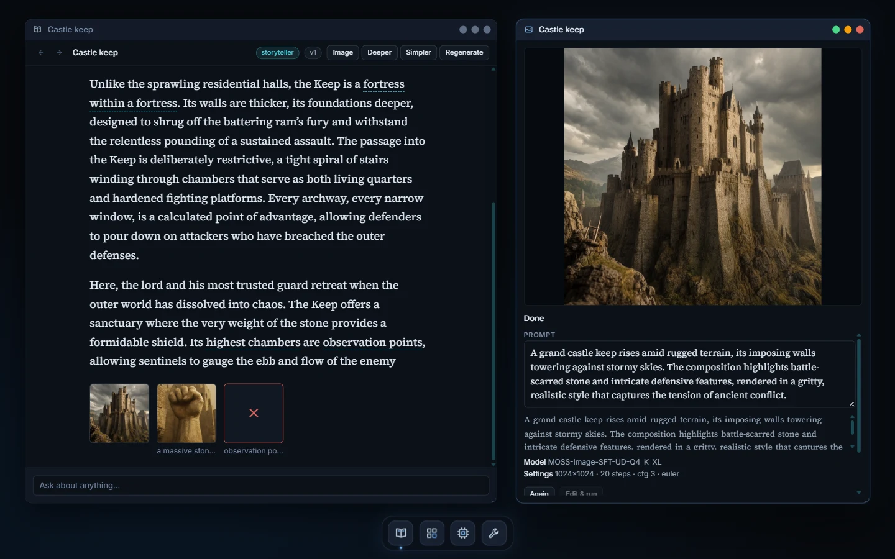
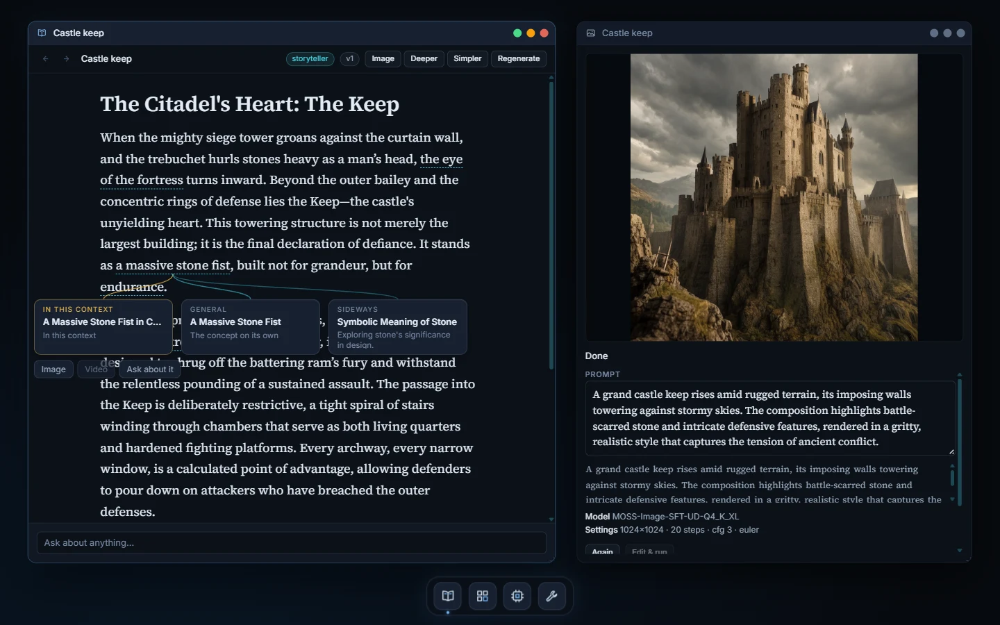
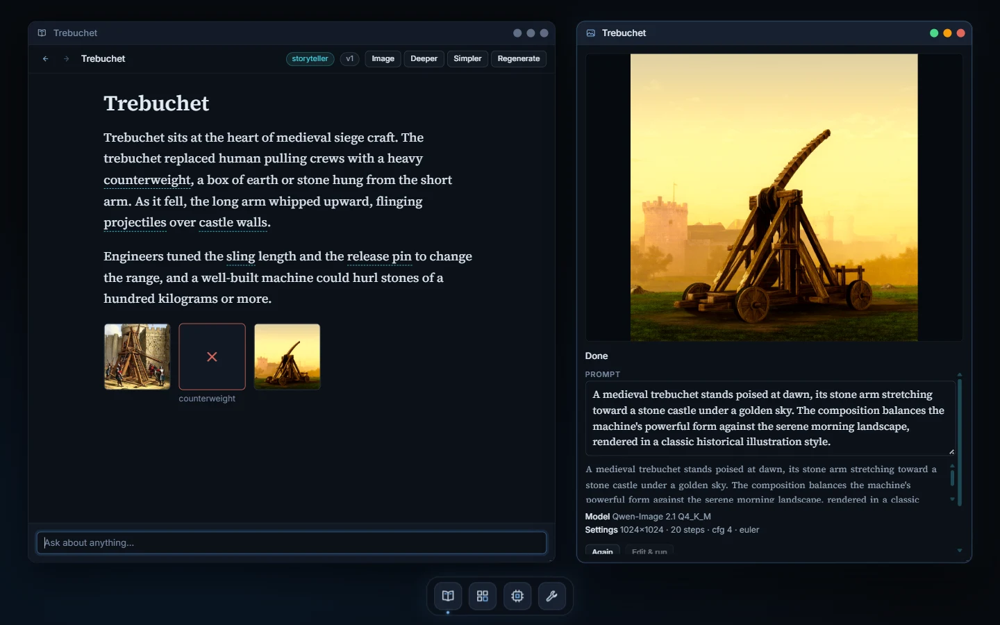
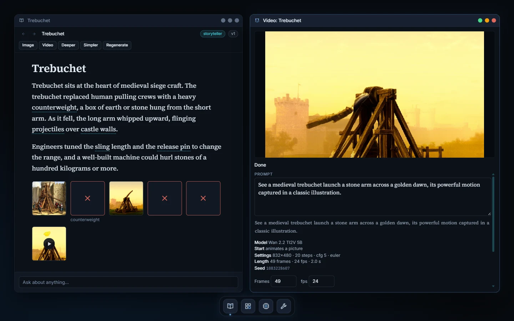
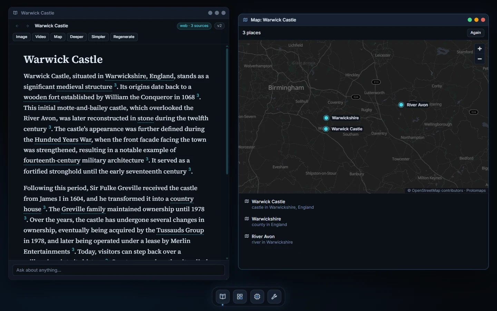
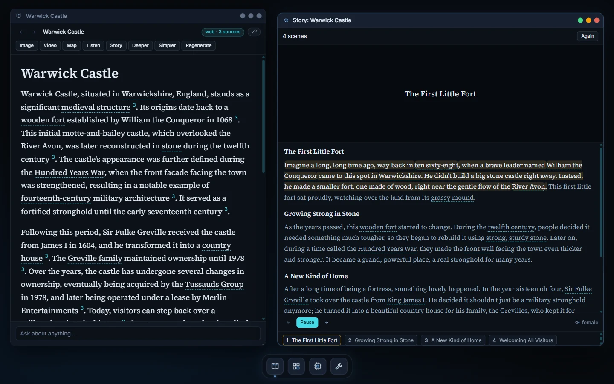
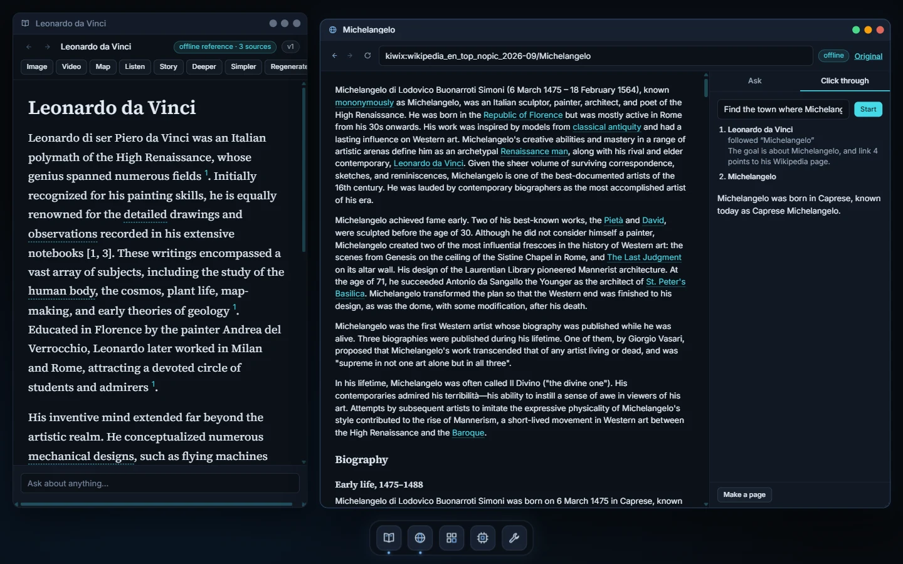
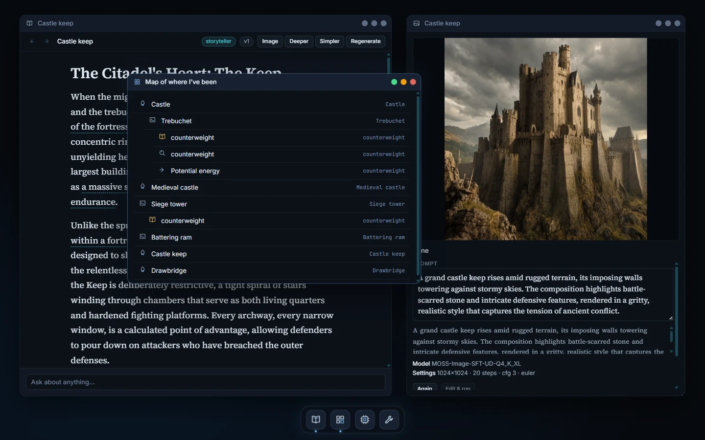

# Primer

**An offline illustrated primer: a book that writes itself as you read it.** Start from a loose
interest, such as castles. Every phrase on the page can be clicked, and each one branches into a
new page: one written in the context you came from, a general article, or a sideways jump.
Any phrase can also be drawn as a picture or turned into a short clip, and any picture can be
animated. You keep reading while they render. A page can be the model's own telling, or grounded
in an offline copy of Wikipedia or the live web, with citations you can follow. The places a page
names can be pinned on an offline map, and every pin opens its own page. And Primer can read to
you: a page aloud, or retold as a short illustrated story.

Primer runs on your own machine against local models (LM Studio, llama.cpp's `llama-server`, or a
hosted OpenAI-compatible API if you choose). Everything you read and every picture it draws is
kept, so your wandering becomes a book you can browse again later.



## What it does

**Pages you can follow anywhere.** Type anything ("castles", "how does a trebuchet work",
"Gilgamesh") and Primer writes a page about it. A small fast model then marks the phrases worth
following. Click one, and Primer offers three branches, already thinking ahead:

- **In this context**: the phrase explained as it is used on this page.
- **General**: the concept on its own.
- **Sideways**: a related idea you might not have thought to ask about.



**Navigate like a website.** Back and forward work the way they do in a browser. **Deeper** and
**Simpler** rewrite the current page at a different level, and **Regenerate** gives you a fresh
take while keeping the old version. Pages are cached, so going back is instant.

**Pictures on demand.** Click **Image** on a page or a phrase, or type "draw a trebuchet at
dawn". Primer turns the page into an image prompt, runs
[stable-diffusion.cpp](https://github.com/leejet/stable-diffusion.cpp) in the background, and
shows live progress in its own window. You can keep reading. Finished pictures sit as thumbnails
on the page they belong to. SDXL, Qwen-Image 2.1 and MOSS-Image are supported, each with its own
settings, and every image records its seed so it can be reproduced.



**Video, and pictures that move.** Click **Video** on a page or a phrase, type "animate a
trebuchet firing", or press **Animate** on a finished picture to use it as the first frame. Primer
writes a prompt about the motion and the camera and makes the clip in the background with the same
stable-diffusion.cpp server. Wan 2.2 (5B, and the two-stage 14B models with LightX2V's 4-step
LoRAs) and LTX-2.3 are supported, with LoRAs per model. Clips loop in their own window and sit on
the page next to its pictures.



**Grounded in Wikipedia or the web.** Pages can be written from sources instead of the model's
memory. In **offline reference** mode Primer searches a local copy of Wikipedia (Kiwix ZIM
files, served by `kiwix-serve`, which Primer starts for you) and works with no network at all.
In **web** mode it searches the web and reads the top pages. Either way the page cites its
sources as small numbered links, lists them at the end, and its badge says what it was grounded
in. The badge doubles as a menu: **Rewrite from** storyteller, offline reference or web. If no
source can be found, Primer says so and writes the page from the model's own knowledge.


**Places on a map.** Click **Map** on a page and Primer pins the places it names on a real map
of the world, drawn offline from a map file on your disk (OpenStreetMap data from
[Protomaps](https://protomaps.com/)). The places are found by the fast model and located from
Wikipedia, never guessed. Click a pin, or a place in the list, to open its page. Type "show me
Bodiam Castle on a map" to go straight there.



**It reads to you.** **Listen** reads the page aloud, highlighting the passage being read.
**Story** retells the page as three to five short scenes, each with its own picture and
narration, played in a Story window that starts the first scene while the rest are still being
made. The voice is a local model (Liquid AI's LFM3-Audio on llama.cpp's `llama-server`, on the
CPU) or any OpenAI-style speech service. Numbers and years are spelled out before they're read.



**A browser that reads.** The **Browser** opens real web pages and offline Wikipedia articles
inside Primer as clean text with their links and pictures. Source links open there too. Select any
phrase to explore it as a page, **Ask** about what's on the page, **Make a page** from it, or give
**Click through** a goal and watch the model follow links to the answer, one step at a time.



**A map of where you've been.** Every page you open joins a concept graph. The map shows the
trail: which page you branched from, and how (in context, general, or sideways).



**It looks after its own models.** Primer starts and stops the model servers it needs. On one
GPU it shares the card for you: in auto GPU mode it pauses the writing model while an image is
drawn, then brings it back, and a page asked for in the meantime waits its turn. The Engines window
shows each server's state and why. The Models window can scan a folder and find complete
models for you.


## Install

Primer has been built and tested on **Windows 11** with an NVIDIA GPU. The server is plain Python
with no dependencies and should run elsewhere too, but that hasn't been tried yet.

### 1. What you need

- **Python 3.11 or newer.** Nothing to `pip install`: the server uses only the standard library.
- **Node.js 20 or newer**, to build the interface once.
- **A text model server**, any one of:
  - [LM Studio](https://lmstudio.ai/) with its `lms` command on your PATH, or
  - [llama.cpp](https://github.com/ggml-org/llama.cpp)'s `llama-server` and a GGUF model, or
  - a hosted OpenAI-compatible API (bring your own key).
- **For pictures and video (optional):** a
  [stable-diffusion.cpp release](https://github.com/leejet/stable-diffusion.cpp/releases) (CUDA,
  Vulkan or CPU build) and at least one model: an SDXL checkpoint, Qwen-Image 2.1 or MOSS-Image
  for pictures; Wan 2.2 or LTX-2.3 for video (see [docs/RUNNING.md](docs/RUNNING.md#video)).
- **For an offline encyclopedia (optional):**
  [kiwix-tools](https://download.kiwix.org/release/kiwix-tools/) and one or more Wikipedia
  [ZIM files](https://download.kiwix.org/zim/wikipedia/), for example
  `wikipedia_en_top_nopic` (2.6 GB, the 50,000 most-read articles in full) or
  `wikipedia_en_all_mini` (13 GB, the opening of every article). See
  [docs/RUNNING.md](docs/RUNNING.md#grounding).
- **For a voice (optional):** a recent llama.cpp `llama-server` and LFM3-Audio-2B with its
  mmproj file, or an OpenAI-style speech endpoint. See [docs/RUNNING.md](docs/RUNNING.md#voice).
- **For the map (optional):** a Protomaps map file. `tools/map_extract.py` makes one for you
  (the whole world in about 1.6 GB), plus Protomaps' free fonts and icons. See
  [docs/RUNNING.md](docs/RUNNING.md#maps).

A good small setup is a 4B to 12B instruct model on the GPU for writing, plus a 1B to 2B model on
the CPU for picking highlights. Measured on an RTX 2060 (12 GB), a page takes about a minute with
gemma-4-E4B.

### 2. Get it and build it

```bash
git clone https://github.com/nihilistau/Primer.git
cd Primer
cd ui && npm install && npm run build && cd ..
```

### 3. Point it at your models

Pick a tier in `tiers/` and edit it to name the models you have:

| Tier | For |
| --- | --- |
| `light` | CPU only, or a small GPU. One small model does everything. |
| `hybrid` | One GPU (8 GB or more). LM Studio for writing, plus a small fast model. |
| `workstation` | A big GPU (20 GB or more) and larger models. |
| `hosted` | A hosted OpenAI-compatible API. |

The model names in the shipped tiers are placeholders; they must match what your server reports
(`lms ls` for LM Studio). To draw pictures, uncomment the `[images]` block and set `sd_server`
to the path of `sd-server`. For the offline encyclopedia, uncomment `[reference]` and set
`kiwix_serve` and `zims`. For the map, uncomment `[map]`; for a voice, `[voice]`. Every option is described in [docs/RUNNING.md](docs/RUNNING.md).

### 4. Run it

```bash
python serve.py --tier hybrid
```

Then open **http://127.0.0.1:8810**. Primer starts the model servers its tier manages, and stops
them when you quit. Without `--tier` it uses the tier you last chose, or suggests one from your
GPU's memory.

To add picture or video models, open **Models** from the dock, paste the folder that holds them
into **Scan a folder**, and click **Add** on each model it finds.

## How to use it

The short version:

1. Type a topic into **Ask about anything...** and press Enter.
2. Click any underlined phrase, then pick a branch.
3. Use **back / forward**, **Deeper**, **Simpler** and **Regenerate** to move around.
4. Click **Image**, or type "draw ...", for a picture. It renders while you keep reading.
5. Click **Video**, type "animate ...", or press **Animate** on a picture, for a short clip.
6. Click **Map** to see the places a page names, pinned on a map. Click a pin to open its page.
7. Click **Listen** to hear the page, or **Story** for an illustrated, narrated story.
8. Click a source, or the globe in the dock, to read the original in Primer's **Browser**.
9. Click the badge in a page's header (`storyteller`) to **rewrite it from** the offline
   encyclopedia or the web. Choose the default for new pages in **Engines**.
10. Open **Map of where I've been** from the dock to see your trail and jump back.

The full guide, including tips, settings and troubleshooting, is in [docs/USING.md](docs/USING.md).

## Privacy and safety

- The server listens on `127.0.0.1` only and answers only Primer's own page. Requests from other
  sites, other hosts or other origins are refused.
- Nothing leaves your machine unless you choose a hosted tier or web mode. In web mode the page's
  title is sent to the search engine (DuckDuckGo by default) and the top results are fetched;
  pages on local or private network addresses are never fetched.
- The map is drawn from the file on your disk. Places are located from the offline encyclopedia,
  or, if web search is on in your tier, from Wikipedia and Wikidata online (only the place's name
  is sent).
- Fetched pages and encyclopedia articles are treated as reference text, never as instructions
  to the model, and are never shown as HTML inside Primer.
- Model files must be local `.safetensors` or `.gguf` files. Pickle formats (`.ckpt`, `.pt`,
  `.bin`) and network paths are refused, and no command line can be set from the browser.

## Status

This is **v0.7**: pages, branching, pictures, video, grounding in an offline encyclopedia or the
web, the map, narrated stories and the reader browser work. A browser that drives a real Chrome
(for sites that need scripts or a login) is planned next. The
design is in [docs/superpowers/specs/](docs/superpowers/specs/), and what changed is in the
[changelog](CHANGELOG.md).

Primer is a sibling of [Kairos](https://github.com/nihilistau/Kairos) and shares its desktop
interface and design language.

## License

MIT. See [LICENSE](LICENSE).
