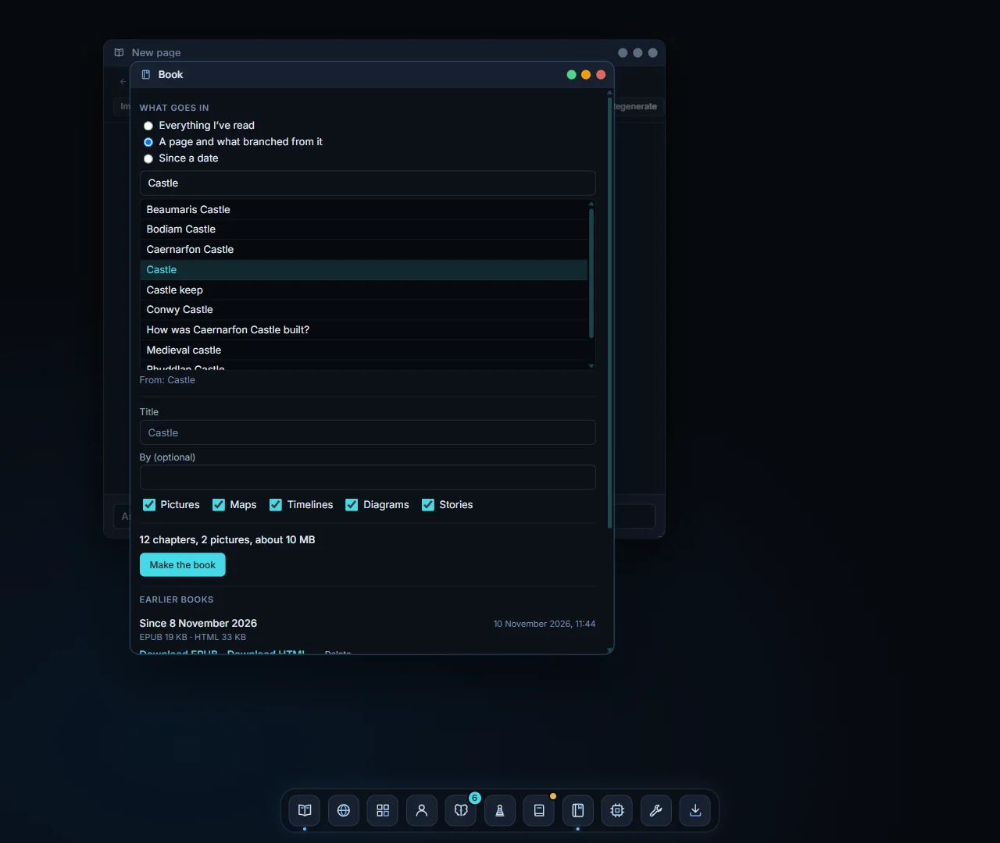
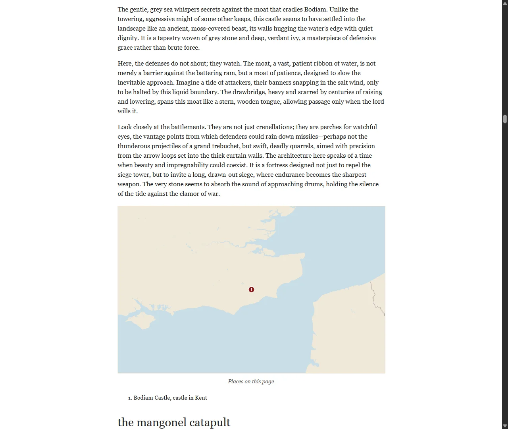

# Using Primer

A guide to setting up, reading, branching, testing yourself, following a tale, grounding, browsing, mapping, listening, drawing and animating with Primer. To install it and point it at your models,
see the [README](../README.md#install). Every configuration option is in [RUNNING.md](RUNNING.md).

## The desktop

Primer opens as a small desktop in your browser. Windows can be moved by their title bar, resized
from any edge or corner, maximised (green), minimised to the dock (amber) or closed (red). The
dock at the bottom opens:

| Dock button | Window |
| --- | --- |
| Book | **New page**: a reader. You can open several readers side by side. |
| Globe | **Browser**: web pages and offline Wikipedia articles, read inside Primer. |
| Grid | **Map of where I've been**: every page you've opened, as a tree. |
| Chip | **Engines**: the tier, the model servers and their states, and the GPU mode. |
| Wrench | **Models**: add, scan, edit and choose picture and video models. |
| Person | **Reader**: what Primer has learned about how you read, your notes about yourself, and Reset. |
| Brain | **Review**: questions from Test me that are due again (the badge shows how many). |
| Pawn | **Quest**: a run through rooms built from your trail, each door opened by a question. |
| Journal | **Tale**: one ongoing illustrated story with your own hero, a chapter at a time from what you've read. |
| Arrow | **Setup**: download a starter kit of models, programs, Wikipedia and a map, move models, check for updates. |

## Setup

Setup gets Primer going without hunting for files. It opens by itself the first time no writing
model is available, and from the dock (the arrow) at any time.

**Install** has four steps on one screen:

1. **Choose a kit.** Setup suggests one from your graphics card, with the reason:
   - **Light** (about 5 GB): for a CPU or a small GPU. LFM3 1.7B writes and does the fast jobs,
     LFM3-Audio reads aloud, the 50,000 most-read Wikipedia articles (introductions), a world map
     to town level, and the llama.cpp and kiwix-tools programs.
   - **Hybrid** (about 27 GB): for an 8 to 20 GB GPU. gemma-4-E4B writes on the GPU, LFM3 does
     the fast jobs and the voice on the CPU, Qwen-Image 2.1 draws, the top Wikipedia articles in
     full, the map to zoom 9, and CUDA builds of llama.cpp and stable-diffusion.cpp.
   - **Workstation** (about 63 GB): as Hybrid with larger quants, plus Wan 2.2 video and the
     opening of every Wikipedia article.
2. **Choose a folder** on an internal drive. Setup shows its free space, and refuses network
   drives, removable drives, the drive itself, the Primer folder and any folder holding it.
   External USB disks are
   allowed but never suggested: models load slowly from them.
3. **Check the plan.** Every item shows its size, licence and source. **Skip** anything you don't
   want, or pick another size from the list beside it (a smaller quant, or on Hybrid and
   Workstation the Vulkan or CPU build). Skipping the writing model, or llama.cpp when no
   llama-server is on the PATH, is refused: no tier could be written without them. Items already
   in the folder show as **Already here** and aren't downloaded again (programs count only once
   this Primer has recorded them; ones another Primer left there are unpacked again, so you can
   approve them as one release). The total is shown against the free space, with room to unpack
   the programs and cut the map.
4. **Accept the licences** (each one once, with a link to read it) and press **Download**.

Downloads run one at a time in the background, with speed and time left. **Pause** and
**Resume** carry on from where they stopped, and so does quitting Primer and starting it again
(the map cut starts again if a newer Protomaps world build appeared meanwhile). A file its
server no longer offers says so: check the plan again to pick up the newer one.
Every file is checked against the hash its publisher gives before it is used (Hugging Face and
Kiwix publish SHA-256, GitHub release files too; kiwix-tools only MD5). The map is cut from the
newest Protomaps world build and checked by reading it back.

**Approve the programs.** Setup never runs a program it downloaded until you approve it. Each
release is listed with its publisher, release and every file's SHA-256; **Approve all from this
release** approves them together. A program or DLL that Setup did not put there (for example one
copied into the folder later) is listed apart, with a warning, and has to be approved on its own.
Primer refuses to start a program in a Setup folder that isn't approved, or whose file has
changed since.

When everything is in, Setup writes a tier called `local-<kit>` (for example `local-light`) with
every path, port and setting filled in, adds the kit's picture and video models to **Models**
(the first of each kind becomes the default if you had none),
and offers **Switch to the new tier**. Setup rewrites that file whole each time, so make a copy
under another name if you want to change it.

A **Hugging Face token** is only needed for gated models (none of the kits use one). Put it in
`var/keys/huggingface.key`; Setup sends it only to huggingface.co.

**Move models** lists the model files your tier and the Models window use, with their drive.
Files on slow drives (external USB disks, removable or network drives) are marked. Tick some,
choose a folder on another drive and press **Move**: each file is copied, checked, and the
Models window and Setup's own tiers are pointed at the copy. Your originals are kept; delete
them yourself when you're happy. Your own tier files are never edited: Setup lists the ones that
still name a moved file. Files Setup installed stay where they are (choose another folder in
Setup to use another drive).

**Updates** lists newer Wikipedia files and newer program releases. Nothing is ever updated on
its own.

## Reading

Type anything into **Ask about anything...** at the bottom of a reader and press Enter: a topic
("castles"), a question ("why did castles stop being built?"), or a name ("Gilgamesh"). The page
streams in as it is written. When it is done, a small fast model marks the phrases worth
following, shown with a dotted underline.

The header of each page shows:

- **The source badge**, which says what the page is grounded in: `storyteller` (the model's own
  knowledge), `offline reference · 3 sources` or `web · 3 sources`. Click it to rewrite the page
  from another source (see [Sources](#sources)).
- **The version**, such as `v1`. Regenerating a page adds a version rather than replacing it.

The buttons beside it rewrite the page you are on:

| Button | What it does |
| --- | --- |
| **Deeper** | The same topic, written for someone who wants more detail. |
| **Simpler** | The same topic, written more plainly. |
| **Regenerate** | A fresh take on the page. |
| **Image** | Draws a picture of the whole page (see [Pictures](#pictures)). |
| **Video** | Makes a short clip of the whole page (see [Video](#video)). |
| **Map** | Pins the places the page names on a map (see [Maps](#maps)). |
| **Timeline** | Puts the dates the page names on a timeline (see [Timelines](#timelines)). |
| **Diagram** | Draws a labelled diagram of how the page's subject works (see [Diagrams](#diagrams)). |
| **Listen** | Reads the page aloud (see [Stories](#stories-and-listening)). |
| **Story** | Retells the page as a short illustrated, narrated story. |

**Back** and **forward** (the arrows at the left) move through the pages you've visited in this
reader, like a browser. Going back shows the saved page instantly. It is never rewritten.

Pages are kept between runs. Typing a topic you've read before opens the saved page straight away.

## Branching

Click any underlined phrase. Primer fans out three branch cards, each with a title it has already
guessed for you:

- **In this context**: what the phrase means here, on this page. For example, "counterweight" on a
  trebuchet page explains the counterweight of a trebuchet.
- **General**: the phrase as a topic of its own.
- **Sideways**: a related idea worth a detour.

Click a card to open that page. Under the cards:

- **Image** draws just this phrase.
- **Ask about it** puts `Tell me about "<phrase>"` into the prompt box, so you can edit the
  question before sending it.
- **Video** makes a short clip of just this phrase.
- **Map** pins just this phrase on a map, if it's a place.
- **Story** opens the phrase's page and tells its story.

Press **Escape** or click elsewhere to close the fork without choosing.

## Sources

A page can be written three ways:

| Mode | Written from |
| --- | --- |
| **Storyteller** | The model's own knowledge. Fast, fully offline, accuracy best-effort. |
| **Offline reference** | Articles from a local copy of Wikipedia. Works with no network. |
| **Web** | The top results of a web search, read live. |

New pages use the default mode, set in the **Engines** window under **Modes → Source**. To
rewrite the page you are reading from another source, click its badge and choose under **Rewrite
from**. The rewrite is a new version; the old one is kept.

While a grounded page is being prepared, the reader says what it is doing: "Searching the
offline encyclopedia…", "Reading 3 articles…", "Searching the web…". Then the page is written as
usual. Facts taken from a source carry a small number, such as ¹, linking to that source. The
**Sources** list at the end of the page names each one and where it came from (the encyclopedia's
title, or the web site). Click one to read it in Primer's [Browser](#the-browser); shift-click
opens it in a new tab of your own browser instead.

If nothing can be found, or the encyclopedia or the web can't be reached, the page is written
from the model's own knowledge instead. Its badge then says `storyteller`, and a line under the
header says why.

A mode that can't be used right now is greyed out, with the reason: no offline encyclopedia set
up in this tier, the reference server not running, or web search turned off. To set up the
offline encyclopedia, see [RUNNING.md](RUNNING.md#grounding).

## The Primer knows you

Primer notices how you read and shapes the next pages to suit, and it can ask you about what you
have read. Everything stays on your machine.

**What it notices**: which branch you take from a phrase (in this context, general or sideways),
whether you ask for **Deeper** or **Simpler**, **Regenerate**, how long a page stays open in a
window you can see (up to 10 minutes a visit), and your answers in Test me and Review.

**Reader** (the person in the dock) shows what it has made of that:

- a short **summary** in plain words ("they ask for simpler pages more than deeper ones; they
  follow sideways links most"), written by the fast model in the background after every 8 pages
  or 5 answers, at most every 2 minutes. **Refresh** writes one now;
- the **counts** behind it: Deeper against Simpler, your share of each kind of branch, and the
  topics you've opened most and stayed on longest;
- what you **know** (right twice in a row in Review) and what you **found hard** (missed twice);
- your **notes**: your own words, which always come first ("I'm 12", "skip the maths"). Up to
  1000 characters; the first 500 go into page prompts;
- **Use this in pages**: on by default. Page prompts then get a short "about this reader" note
  (your notes, the summary and the counted leans, 800 characters at most), and branch cards and
  highlights get your branching style. It is passed to the model as your preferences, never as
  instructions: it can't change a grounded page's rules or citations. Off, nothing of it is
  used, and Refresh is refused;
- **Reset**: forgets how you read, the summary, your notes, every Test me and Review question
  and every quest, in one go. Your pages stay.

Changing your notes, the switch, or Reset also throws away pages Primer had written ahead for
you (Thinking ahead), so they are rewritten to suit. If your tier uses a hosted model, the
Reader window says what it receives: the writing model gets the note with each page request; the
fast model gets page titles, counts and quiz results to write the summary.

The summary waits while the fast model is busy with branch cards, but never more than 5 minutes,
and **Refresh** doesn't wait: on a CPU fast model a page's highlights may then arrive about 10
seconds later.

### Test me

**Test me** on the page toolbar asks three questions about the page you're reading: one
**recall**, one **explain why**, and one that **connects** it to a page you read earlier (it
names that page; with no earlier pages, a second why). The writing model makes them, so they
wait for the GPU like a page does.

Type an answer and press **Check**. It is marked **Right**, **Partly** or **Not yet** against the
page, with a line of feedback quoting it; paraphrase counts. **Show answer** gives the page's
answer; if you look before checking, the question counts as not yet and comes back tomorrow.
**New questions** asks for another three once all are answered. The panel closes when the page
is rewritten (Deeper, Simpler, Regenerate).

### Review

Questions come back on a ladder: **Not yet** tomorrow, **Partly** in 2 days, and each **Right**
moves one up: 1, 3, 7, 21, then every 60 days. **Review** (the brain in the dock, with the number
due) lists what is due; answer them the same way. Click a page's title to reread it. With
nothing due it says when the next one is.

### Quest

**Quest** (the pawn in the dock) builds a run of up to five rooms from the pages you read most
recently, or, from the **Quest** button on a page, from the trail that led to it. Each room is a
page, described in a sentence as a place ("You stand in the courtyard where the massive trebuchet
swings its heavy arm…"), with a door that opens on a question about that page. Rooms ahead stay
locked until you reach them.

A wrong answer shows **Not yet** and the door's hint, then a nudge to reread the page (with a
link to it); after three tries you can **Skip** the room. The page's answer is shown only once
the door opens or you skip. The last door ends the run with how many rooms you opened. **Leave
this quest** gives up on it so you can build another. A quest needs at least two pages read.

![A page about cannons with its Test me panel open: a recall question answered "Gunpowder: an explosive powder throws the heavy ball" and marked Right with the page quoted, an explain-why question marked Right, and a connect question asking how cannons relate to the Theodosian Walls; beside it the Reader window with a summary saying the reader asks for simpler pages and follows sideways links, bars for Deeper 0 and Simpler 3, branch shares of 20% in context, 10% general and 70% sideways, and the topics read most with minutes on each](screenshots/test-me-and-reader.webp)

## The Tale

A **Tale** is one long story that goes on as you read: the same hero and companions, chapter
after chapter, and each chapter woven from the pages you've read since the last one. Read about
water clocks and siphons, and the next chapter has the hero puzzling over one in the castle's
cistern.

**Start a tale** in the Tale window (the journal in the dock): describe the hero ("a girl called
Wren, apprentice to a castle engineer, who asks too many questions", up to 500 characters) or
press **Invent one for me**. Primer writes the **story bible**: the hero's name, whether they're female or male, a
short description and a fixed **look** for pictures, a companion or two, a place, and an opening
thread. Your notes in Reader (for example "I'm 12") set the tone.

**Next chapter** shows the pages it will draw on: up to three of the pages you've read since the
last chapter (for the first chapter, since a day before the tale began), the ones you spent
longest on first. Untick any, or **Add a page from your trail**. The Tale button in the dock gets
a mark when three new pages are waiting. Pages that weren't used drop out of the list after the
chapter; you can still add them from your trail.

A chapter is 3 to 5 scenes that carry on from the last one and keep the facts from your pages
true. It plays in the Story window ("Chapter 2 of …") with a picture per scene and the voice
reading it, and it appears in the stories of every page it drew on. Every picture starts with the
hero's look ("Wren, female: messy brown braid, worn leather apron…"), so the hero stays
recognisable; companions' looks are added when they're in the scene. The pictures are drawn as
storybook scenes.

After each chapter Primer updates the bible: new companions, places, things the characters carry,
threads opened and closed, and a summary of the chapter. If that update fails the chapter is
kept and the window offers **Retry**. You can edit the hero (name, female or male, description, look)
and remove a place or a thread.

A chapter needs the voice (it is narrated): with no voice in the tier, or while it's starting,
Next chapter says so. **Start a new tale** keeps the old one under **Older tales**, where you
can reopen it. Reset in Reader doesn't touch tales.

## Thinking ahead

While you read, Primer writes the page you are most likely to open next: the **In this context**
card of the first underlined phrase (and, set to two pages, its **General** card too). When you
click it, it is already there. A card that has been written ahead shows a small mark (hover:
"Already written").

It only uses the GPU when nothing else wants it. The moment you ask for a page, a picture or a
clip, the draft stops and steps aside (a page waiting for it says "finishing a draft…" for a
fraction of a second). If you open a page while it is still being drafted, you get what is
written so far at once and the rest as it streams. Pages written ahead are invisible until you
open them: they don't appear in the map or your history.

Choose **Off**, **One page** or **Two pages** in **Engines → Modes → Thinking ahead**. The same
row shows how many pages were written ahead, how many you used, and the hit rate. It is on by
default (one page) when the writing model runs on this machine's GPU in auto mode; off otherwise
(a hosted model you pay for, a model on the CPU, or manual GPU mode, where Primer can't keep it
out of the way of your own jobs). You can still turn it on.

When you open another page, drafts for the page you left are dropped rather than finished.

## The map

**Map of where I've been** lists every page you have opened, indented under the page you branched
from. An icon shows how you got there: started there, typed, in context, general or sideways. Click any
row to open that page in a new reader.

## Pictures

There are three ways to ask for a picture:

1. **The Image button** in a page's header draws the whole page.
2. **Image on a branch fork** draws a single phrase.
3. **Typing a request** in the prompt box, such as:
   - "draw a trebuchet at dawn"
   - "paint / render / sketch / illustrate a castle keep at night"
   - "generate / create / make an image (or picture) of a siege tower"
   - "show me what a battering ram looks like"

   Ordinary questions that merely contain these words ("how do I draw blood?", "paint a rosy
   picture") are read as questions, not drawing requests.

An **Image window** opens at once and shows what is happening:

| Status | Meaning |
| --- | --- |
| Writing the prompt... | The fast model is turning the page or phrase into an image prompt. |
| Waiting for the GPU | Another image is ahead of this one, or the GPU is being freed. |
| Loading the model... | `sd-server` is starting and loading the model. The first image after a while takes longest. |
| Step N of M | Drawing, with a live preview that sharpens as it goes. |
| Decoding... | The last step is done and the result is being decoded; for a video this can take a while. |
| Done | The picture, its prompt, the model and the settings used. |
| Failed: ... / Cancelled | With the reason. A failed picture has a **Retry** button. |

You can keep reading, branching and opening pages while it draws. When it is done, the picture also
appears as a thumbnail at the bottom of the page it belongs to; click a thumbnail to open it again.

In the Image window:

- **Cancel** stops a picture that is still being made. The GPU is freed within about 15 seconds.
- **Again** draws it again with a new random seed.
- **Edit & run** lets you change the prompt, the model or the settings, then draw.
- Click any word of the prompt to explore it as a page.

Every picture records the seed it actually used, so you can reproduce one by running it again with
that seed.

## Video

Video works like pictures, and a clip is always made in the background. There are four ways to
ask for one:

1. **The Video button** in a page's header makes a clip of the whole page.
2. **Video on a branch fork** makes a clip of a single phrase.
3. **Animate** in a finished Image window brings that picture to life: the picture is the first
   frame, and the model decides how it moves.
4. **Typing a request** in the prompt box, such as:
   - "animate a trebuchet firing"
   - "make / create / generate a (short) video, clip or animation of a castle siege"
   - "film the drawbridge rising"
   - "show me a video of a catapult"

   Questions that only mention these words ("how do I make a video?", "animated films",
   "animate vs inanimate") are read as questions.

A **Video window** opens at once, with the same statuses as the Image window. The fast model
writes a prompt that describes the subject, the motion and the camera. When the clip is done it
plays in a loop, with its prompt, model, settings, length (frames, frames per second and
seconds) and seed. **Cancel**, **Again**, **Retry** and **Edit & run** work as they do for
pictures; Again on an animated picture animates the same picture again.

Clips appear as thumbnails at the bottom of their page, next to the pictures, marked with a play
glyph.

Making video is slow on a 12 GB card. Expect a few minutes for a 2 to 3 second clip (see
[RUNNING.md](RUNNING.md#measured-video-speeds)).

## Maps

Click **Map** in a page's header. A **Map window** opens and says what it is doing: "Finding
places…" while the fast model reads the page for the places it names, then "Locating places…"
while each one is looked up. Then the places appear as pins on a map of the world, and as a list
under it, each with what kind of place it is.

- **Click a pin, or a place in the list,** to open that place's page in the reader (shift-click
  or middle-click for a new reader). It's recorded as a General branch from the page you mapped.
- **Zoom** with the mouse wheel or the + and − buttons. The world map has detail down to about
  city level; closer in, roads and labels stretch rather than add detail.
- **Again** finds and locates the places afresh.
- Places that couldn't be located are listed as "not found". Primer never guesses where a place
  is: every pin comes from a Wikipedia article's coordinates (or, online, from Wikidata).

You can also:

- click **Map** on a branch fork to pin just that phrase, or
- type a request such as "show me Bodiam Castle on a map", "map of Normandy" or "Hadrian's Wall
  on a map". Primer opens the page and its map together.

Maps are saved with the page. They appear in the page's thumbnail strip with a map glyph; click
one to open it again.

Places are looked up first in the offline encyclopedia. When the place's description names where
it is ("river in Warwickshire"), Primer tries that article first ("River Avon (Warwickshire)")
so the pin lands on the right one. If web search is on in your tier, Wikipedia and Wikidata
online fill the gaps, for example for counties and regions whose articles carry no coordinates.

To set the map up, see [RUNNING.md](RUNNING.md#maps).

## Timelines

Click **Timeline** in a page's header. The fast model reads the page (and, for a grounded page,
its sources again) for the events it dates, and a **Timeline window** shows them on an axis:

- A year is a point; a span ("1277 to 1283", "the 12th century", "the 1640s") is a bar. Dates
  before the common era work too ("300 BC"). "c." and "about" dates are marked as approximate.
- Labels stack in rows so they never overlap. **Zoom** with the + and − buttons, the + and − keys
  or ctrl + wheel; **pan** with the arrow keys or by dragging; **Fit** (or 0) shows every event.
  A plain wheel scrolls a tall timeline.
- **Click an event** to open a page about it (shift-click or middle-click for a new reader).
- **All my timelines** puts every page's latest timeline on one axis, coloured by page, with a
  legend. **Again** reads the dates afresh.
- A page that dates nothing says "No dated events on this page". Primer never guesses a date the
  page doesn't give, though a small model can pin a date to the wrong event: the page is the
  authority.

You can also type a request such as "timeline of the Wars of the Roses" or "the Tudors on a
timeline". Primer opens the page and its timeline together.

## Diagrams

Click **Diagram** in a page's header for a labelled, black-on-cream line drawing of how the
page's subject works: the parts of a trebuchet, the vessels of a water clock, the path of water
through a siphon. The writing model draws it as SVG; it takes a GPU turn like a page.

- **Click a label** (on the drawing or in the list under it) to open a page about that part.
- **Zoom** with the + and − buttons or ctrl + wheel (scroll to move around), **Fit** to see it all.
  **Again** draws a new one.
- The caption under it says in a sentence what the drawing shows.
- On a branch fork, **Diagram** draws just that phrase. Or type "diagram of a trebuchet", "draw
  me a diagram of a water clock" or "show me a diagram of how a siphon works".

Diagrams are schematic: boxes, lines, arrows and labels, as good as the writing model's sense of
the machine. A small model's drawing can be muddled or physically wrong; **Again** often helps.
Every drawing is checked twice before it is shown (on the server and again in the window): only
plain shapes, text and arrowheads are kept, and nothing in it can run code, load anything or
link anywhere.

## Your book

Click **Book** in the dock to turn what you've read into a book. Choose what goes in:

- **Everything I've read.**
- **A page and what branched from it.** Pick the page from a searchable list of the pages you've
  read.
- **Since a date.**

The title starts as "My wanderings", the page's title, or "Since" and the date. Change it, and
add a **By** line if you like. The switches turn pictures, maps, timelines, diagrams and stories
on or off. A line under them tells you what you'll get, for example "42 chapters, 12 pictures,
about 64 MB".

Click **Make the book**. It is made in the background and shows its progress ("EPUB: chapter 12
of 40"). Then you can click **Download EPUB** or **Download HTML**. Earlier books are listed
below; download one again, or delete it (the window asks you to confirm first).

Each page you read is a chapter, in the order of your trail. A chapter has:

- a "From phrase in Parent page" line saying where it branched from;
- the page text, with citations linked to a numbered Sources list at the end (web links only;
  offline encyclopedia links show as plain text);
- the page's pictures, up to 6 a chapter;
- each finished map as a drawn plate, with numbered pins and a list of the places. The plate is
  drawn from your offline world map. Without one, the pins sit on a plain grid with the note
  "Drawn without the world map";
- the timeline as a list of dates, and the diagram;
- "A video clip was made of this page in Primer." where a clip was made.

Stories and Tale chapters go in a Stories part, with the words only and no audio. The cover has
the title, the By line, the dates and the first picture. The contents follow your trail: a
chapter sits under the page it branched from. A note at the end says what was left out.

Pick the format by where you will read it:

- **EPUB** opens in an e-reader or a reading app on a phone.
- **HTML** is one file that opens in any browser. The pictures are inside it, it runs no
  scripts and it doesn't link back to Primer. A browser can print it.

A book holds up to 1000 chapters and 300 pictures, and a file up to 400 MB. If it is too big,
Primer says "Too big: leave out pictures or choose less". Titles are up to 120 characters and
the By line up to 80. One book is made at a time. Your Reader notes, profile, Test me
questions, quests and the Tale's bible are never put in a book.

## Stories and listening

Primer can read to you.

- **Listen** reads the page aloud. A window opens with the text as it is read: headings, links
  and citations are dropped and numbers are spelled out. Press **Play**; the
  passage being read is highlighted, and the next part follows on its own. Long pages are read in
  parts, so the first part can play while the rest is still being voiced.
- **Story** retells the page as a short story of three to five scenes, each with a title, a
  picture and narration. The Story window shows the current scene's picture large, its text with
  the passage being read highlighted (the text is shown as it is read, as for Listen), and a strip of scenes. Use the arrows to move between
  scenes. If the next scene isn't ready yet, the window says "Waiting for scene N…" and carries
  on when it is.
- Type "tell me a story about a dragon" or "read me a story about Hadrian's Wall" to open the
  page and its story together.

Phrases in a story are underlined and clickable, as on a page. Pictures are made in the
background through the usual picture queue; without a picture model, scenes show their title
instead. **Again** writes a new story. Stories and readings are saved with the page and appear
in its thumbnail strip.

Numbers and years are spelled out before they are read ("1068" is read as "ten sixty-eight"),
because the voice model misreads digits.

To set up the voice, see [RUNNING.md](RUNNING.md#voice).

## The browser

The **Browser** (the globe in the dock, or any source link) opens real pages inside Primer: web
pages, and articles from the offline encyclopedia (addresses starting `kiwix:`). Pages are shown
as clean text with their headings, lists, tables, pictures and links. There are no scripts,
layouts, forms or logins: it is a reader, not a full browser.

- Type an address or search words into the address bar. Words search the web when web search is
  on, else the offline encyclopedia.
- **Back**, **Forward** and **Reload** work per window. Links open in the same window
  (ctrl-click or middle-click for a new one). **Original** opens the page in a tab of your own
  browser.
- **Select any text** to **Explore** it (a Primer page on it) or **Ask** about it.
- **Ask** (side panel) answers a question about the page from its text, such as "What's on this
  page?".
- **Click through** takes a goal ("Find the town where Michelangelo was born") and lets the
  writing model follow the page's links for you, up to five pages, showing each step and why. It
  only ever follows links the page offers. How well it chooses depends on the writing model; a
  small model can wander. **Stop** ends it at any time.
- **Make a page** writes a Primer page about the page you're reading, grounded in it alone and
  citing it.

Pages fetched from the web go through the same checks as web sources: only public addresses,
with size and time limits. Pictures are passed through Primer and checked to be real pictures.

## Models

Open **Models** from the dock. It has two lists, **Pictures** and **Videos**, each with its own
default (the star).

- **Scan a folder**: paste the absolute path of a folder holding picture or video models and click **Scan**.
  Primer reads the file headers (it never loads the models) and proposes each complete model it
  recognises, with its family and files. Click **Add** on the ones you want. A model that is
  missing a file is shown with what is missing. Video models are found with their shared text
  encoder and VAE, and any LoRAs in a `loras` folder beside them.
- **New model**: choose a family and fill in the file paths yourself.
- **Click a model** to edit its name, files and settings. Each file shows `found` or `missing`.
- The **star** marks the default model of each list, used for new pictures or clips. The first
  model you add to a list becomes its default; choose another with **Make default**.

Settings per model:

| Setting | Meaning |
| --- | --- |
| Width, Height | Size in pixels (256 to 2048 for pictures, 256 to 1280 for video; rounded to what the model needs). |
| Steps | More is slower and finer. 20 is a good start. |
| CFG | How closely to follow the prompt. SDXL likes about 5 to 7; Qwen-Image and MOSS-Image about 3 to 4. |
| Sampler | The denoising method. `euler` works for all three families. |
| Seed | Leave blank (or -1) for a new picture each time; set a number to repeat one. |
| Avoid | Things to keep out of the picture (a negative prompt). |
| Offload to CPU | Keeps parts of the model in system RAM. Slower, but lets big models fit a 12 GB card. |
| Frames, FPS | Video only. The clip's length is frames ÷ FPS, shown as **Length**. Wan rounds frames to 4n+1 (33, 49, 81), LTX to 8n+1 (49, 97, 121). |
| High-noise steps, High-noise CFG, MoE boundary | Wan 2.2 A14B only. These models draw in two stages, a high-noise model for the layout and a low-noise model for the detail. |
| LoRAs | Small add-on files. Each has a strength (0 to 2) and, on two-stage models, a stage: high, low or both. All of a model's LoRAs must be in one folder. |

The three supported families:

| Family | Files | Notes |
| --- | --- | --- |
| SDXL | One checkpoint (`.safetensors`), optional separate VAE | Fastest: about 40 s per image on an RTX 2060. |
| Qwen-Image 2.1 | Diffusion model, Qwen3-VL-8B text encoder, Qwen-Image 2.1 VAE | Follows long prompts well. About 4 minutes per image on an RTX 2060. |
| MOSS-Image | Diffusion model, Qwen3.5-9B text encoder, VAE, `tokenizer.json` | About 4.5 minutes per image on an RTX 2060. |

The video families:

| Family | Files | Notes |
| --- | --- | --- |
| Wan 2.2 TI2V 5B | Diffusion model, UMT5-XXL text encoder, Wan 2.2 VAE | The lightest. Text or picture to video. |
| Wan 2.2 T2V A14B | High-noise and low-noise diffusion models, UMT5-XXL, Wan 2.1 VAE | Text to video. With LightX2V's 4-step LoRAs it needs only a few steps. |
| Wan 2.2 I2V A14B | As T2V, but the image-to-video models | Animate only: it needs a picture to start from. |
| LTX-2.3 distilled | Diffusion model, Gemma 3 12B text encoder, embeddings connectors, LTX-2.3 video VAE | 8 steps at CFG 1. Text or picture to video. |
| LTX-2.3 dev | As distilled | The full model: about 20 steps at CFG 3. |

Keep model files, and `sd-server` itself, on an internal drive. Loading from an external hard disk
can take many minutes, and a disk that drops off while a model is loaded makes `sd-server` crash.

## Engines and tiers

**Engines** shows the tier you are using and lets you switch to another. Each model server has a
state:

| State | Meaning |
| --- | --- |
| ready | Primer started it, and it is answering. |
| external | It was already running (or you run it yourself). Primer uses it but never stops it. |
| starting | Primer started it and is waiting for it to answer. |
| stopped | Not running. The reason says why. |
| failed | It could not be started. The reason says exactly what went wrong. |

**Start** and **Stop** control a server by hand. The **Image server** row shows `sd-server`, which
Primer starts when a picture is needed. The **Reference server** row (when the tier has an offline
encyclopedia) shows `kiwix-serve`, which Primer starts with everything else. **Modes → Source**
sets the default source for new pages.

### Sharing one GPU

With the GPU mode on **auto** (the default), when a picture needs the GPU, Primer pauses the writing
model, draws, then shuts `sd-server` down and brings the writing model back (about 20 seconds). A
page you ask for while a picture or video is being made shows "paused for a picture or video" and
is written straight after. On LM Studio tiers, pausing unloads LM Studio's models, and the first page afterwards waits
while LM Studio loads the model again.

With **manual** GPU mode, Primer leaves your servers alone and keeps `sd-server` loaded between
pictures. Use it if you have enough VRAM for both, or prefer to manage memory yourself.

## Tips

- **A good pair of models**: a 4B to 12B instruct model on the GPU for writing, plus a 1B to 2B
  model on the CPU as the fast model for highlights, prompts and branch titles.
- **Faster pictures**: SDXL at 20 steps is the quickest. Lower the steps for drafts.
- **Out of VRAM?** Turn on Offload to CPU, lower the size, or use auto GPU mode so the writing
  model steps aside.
- **Your data** lives in `var/`: the concept graph (`primer.sqlite`), pictures (`var/media/`) and
  your models (`images.json`). Back up that folder to keep your book. Grounded pages keep the
  list of their sources with them.

## Troubleshooting

| You see | Try |
| --- | --- |
| A server `failed` with "launch command not found" | The program in the tier's `launch` line isn't on your PATH. Use its full path. |
| `failed` with HTTP 401 | LM Studio has "Require API key" on. Put the key in a file and set `api_key_file` in the tier. |
| Pages never arrive | Check the Engines window, and that `model` in the tier matches what your server reports (`lms ls`). |
| Image button disabled | Hover it for the reason: no `sd_server` in the tier, no image model added, or no default chosen. |
| A picture failed with "Primer restarted" | Primer was stopped while it was drawing. Click **Again**. |
| "already answering" for the image server | Something else holds the image port, perhaps a leftover from a crash. Primer clears its own leftovers on the next start; otherwise stop it, or change `port` under `[images]`. |
| Thumbnails show a red cross | That picture failed. Open it to see why. |
| Video button disabled | Hover it for the reason: no video model added, or no default video model. |
| "Web is off in this tier; only the offline encyclopedia can be opened" in the Browser | The tier's `[web]` search is `off`, so only the offline encyclopedia (`kiwix:` addresses) can be read. |
| A page in the Browser has no pictures | The offline Wikipedia files have none ("nopic"); web pages do. |
| Listen and Story disabled | Hover them for the reason: no `[voice]` in the tier, or the voice server isn't running. |
| "cannot reach the voice server … timed out" | The voice model runs on the CPU. If other programs are using most of the CPU, a passage can take minutes; close them, or raise `timeout_s` under `[voice]`. |
| Map button disabled | Hover it for the reason: no `[map]` in the tier, the map file can't be read, or no way to look places up (no offline encyclopedia and web search off). |
| A place is "not found" | Its article has no coordinates, or there's no article. With web search on, Primer also asks Wikipedia and Wikidata online. |
| "Some map tiles could not be loaded" | The map file or the fonts folder in `[map]` has moved, or Primer stopped. |
| Animate disabled | No video model that can start from a picture (Wan 2.2 TI2V 5B, Wan 2.2 I2V or LTX-2.3). |
| A grounded page came out as `storyteller` | Read the line under the header: no source was found, or the encyclopedia or web couldn't be reached. Check the Reference server in Engines. |
| The Reference server `failed` | Check `kiwix_serve` and `zims` in the tier: the paths must exist, and each file must be a complete ZIM (compare its `.sha256`). |
| "empty response" on a grounded page | A thinking model used its whole budget thinking. Turn thinking off with `[text.extra]` (see [RUNNING.md](RUNNING.md#tiers)). |
| `sd-server stopped while generating (exit code 3221225478)` | Windows couldn't read part of `sd-server` or a model file, usually an external disk that disconnected. Move them to an internal drive. |
